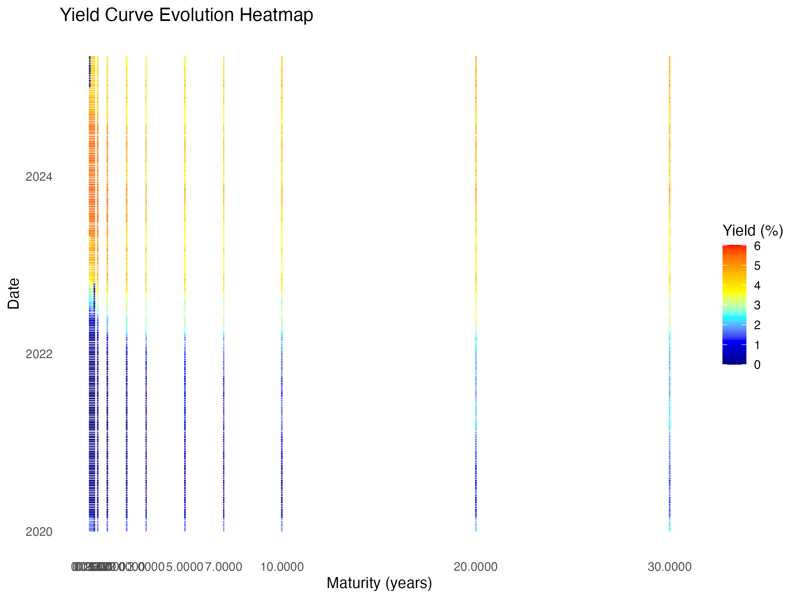
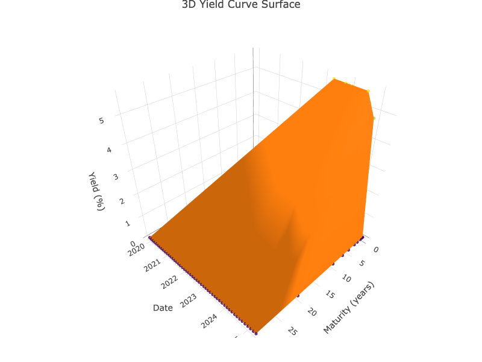
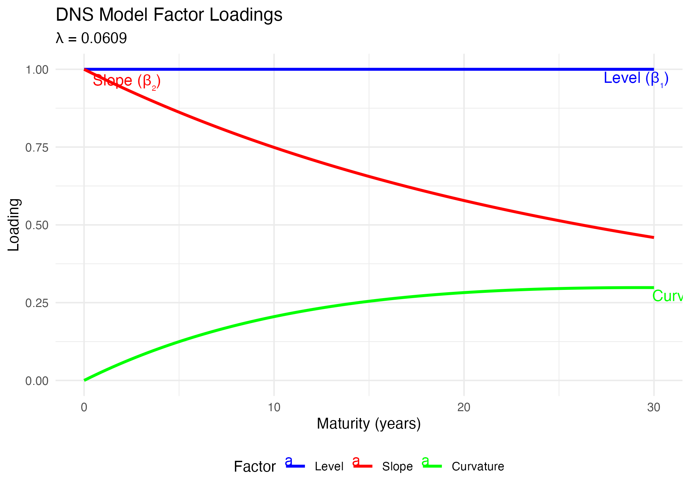
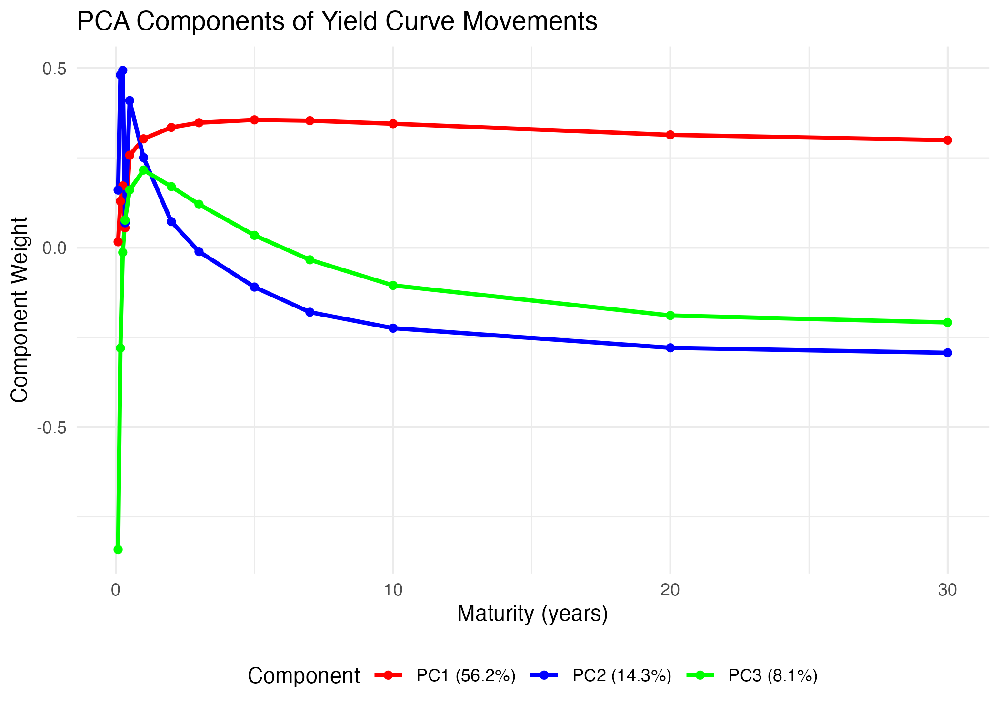

# dnsr: Dynamic Nelson-Siegel Model in R

[](https://travis-ci.org/username/dnsr)
[](https://CRAN.R-project.org/package=dnsr)
[](https://codecov.io/gh/username/dnsr?branch=master)
[](https://www.tidyverse.org/lifecycle/#stable)

## Overview

The `dnsr` package provides a comprehensive implementation of the Dynamic Nelson-Siegel (DNS) model for yield curve modeling and analysis. It offers a complete workflow from data acquisition to model fitting, factor dynamics estimation, advanced stochastic simulation, and visualization.



## Features

- **Data Acquisition**: Download and process U.S. Treasury yield curve data
- **Model Calibration**: Robust fitting of the DNS model to yield curve time series
- **Factor Dynamics**: Estimate stochastic processes governing yield curve evolution
- **Advanced Simulation**: Generate future yield curve scenarios using rigorous SDE simulation via YUIMA
- **Visualization**: Create informative plots of yield curves and model results
- **Parallel Processing**: Support for faster model fitting with multiple cores

## Installation

```r
# Install development version from GitHub
devtools::install_github("ambientpointcorp/dnsr")

# For advanced simulation capabilities, also install YUIMA
install.packages("yuima")
```

## Quick Start

```r
library(dnsr)

# Download Treasury yield curve data
yield_data <- get_treasury_yield_combined(start_date = "2020-01-01")

# Fit the DNS model
dns_result <- fit_dns_model(yield_data, n_days = 100)

# Visualize the results
plot_yield_curves(yield_data, dns_result)
factor_plots <- plot_factor_time_series(dns_result)
print(factor_plots$factors)

# Estimate factor dynamics
dynamics <- estimate_dns_dynamics(dns_result$parameters)

# Simulate future yield curves with advanced SDE methods (requires YUIMA)
params <- dns_dynamics_to_sim_params(dynamics)
initial_factors <- dns_result$parameters[1, c("beta1", "beta2", "beta3")]
maturities <- c(0.25, 0.5, 1, 2, 3, 5, 7, 10, 20, 30)

sim_result <- simulate_dns_yield_curves(
  params = params, 
  initial_factors = as.numeric(initial_factors),
  maturities = maturities,
  sim_method = "euler"  # Using YUIMA's Euler-Maruyama scheme
)

# Plot simulation results
yield_plots <- plot_simulated_yields(sim_result, time_points = c(0, 1, 5, 10))
print(yield_plots$yield_curves)
```

## Advanced Stochastic Simulation

The package leverages the YUIMA framework for accurate simulation of stochastic differential equations. This provides:

- **Mathematical Rigor**: Proper implementation of numerical SDE schemes (Euler-Maruyama, Milstein)
- **Correlation Handling**: Accurate simulation of correlated factors
- **Statistical Estimation**: Advanced methods for parameter estimation
- **Numerical Stability**: Better performance for longer time horizons

```r
# Create a YUIMA model from DNS parameters for advanced analysis
yuima_model <- dns_to_yuima_model(params)

# Estimate parameters using advanced statistical methods
est_result <- estimate_dns_parameters_yuima(factor_data, estimation_method = "qmle")
```

## The Nelson-Siegel Model

The Nelson-Siegel model expresses the yield curve as:

$$y(m) = \beta_1 + \beta_2 \left(\frac{1-e^{-\lambda m}}{\lambda m}\right) + \beta_3 \left(\frac{1-e^{-\lambda m}}{\lambda m} - e^{-\lambda m}\right)$$

where:
- $y(m)$ is the yield at maturity $m$
- $\beta_1$ represents the long-term level of interest rates
- $\beta_2$ represents the yield curve slope
- $\beta_3$ represents the curvature
- $\lambda$ controls the decay rate of factor loadings

In the dynamic extension, the factors $\beta_1$, $\beta_2$, and $\beta_3$ are modeled as mean-reverting Ornstein-Uhlenbeck processes:

$$d\beta_i(t) = \kappa_i(\theta_i - \beta_i(t))dt + \sigma_i dW_i(t)$$

## Visualizations

The package includes advanced visualization capabilities:

### 3D Yield Surface


### Factor Loadings


### Principal Component Analysis


## Documentation

For detailed documentation and examples, see the package vignettes:

```r
# Basic introduction to the DNS model
vignette("dns-model-introduction", package = "dnsr")

# Advanced simulation with YUIMA integration
vignette("dnsr-yuima-integration", package = "dnsr")
```

## Applications

The `dnsr` package is useful for:

- **Interest Rate Risk Management**: Model yield curve shifts for risk analysis
- **Economic Scenario Generation**: Create consistent interest rate scenarios
- **Asset-Liability Management**: Simulate future yield curves for ALM studies
- **Fixed Income Research**: Analyze yield curve dynamics and factor behavior
- **Stress Testing**: Generate extreme but plausible scenarios for risk management

## Citation

If you use `dnsr` in your research, please cite:

```
@Manual{,
  title = {dnsr: Dynamic Nelson-Siegel Model in R},
  author = {Ariel R. H.},
  year = {2025},
  note = {R package version 0.1.0},
  url = {https://github.com/ambientpointcorp/dnsr},
}
```

## License

MIT © Ambient Point Corp.
