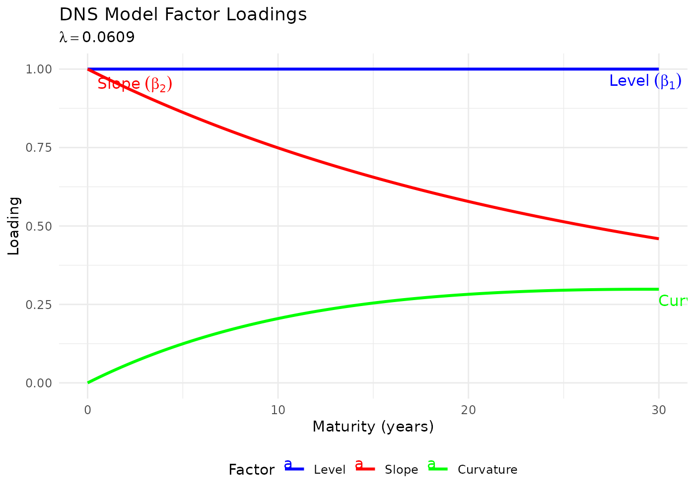
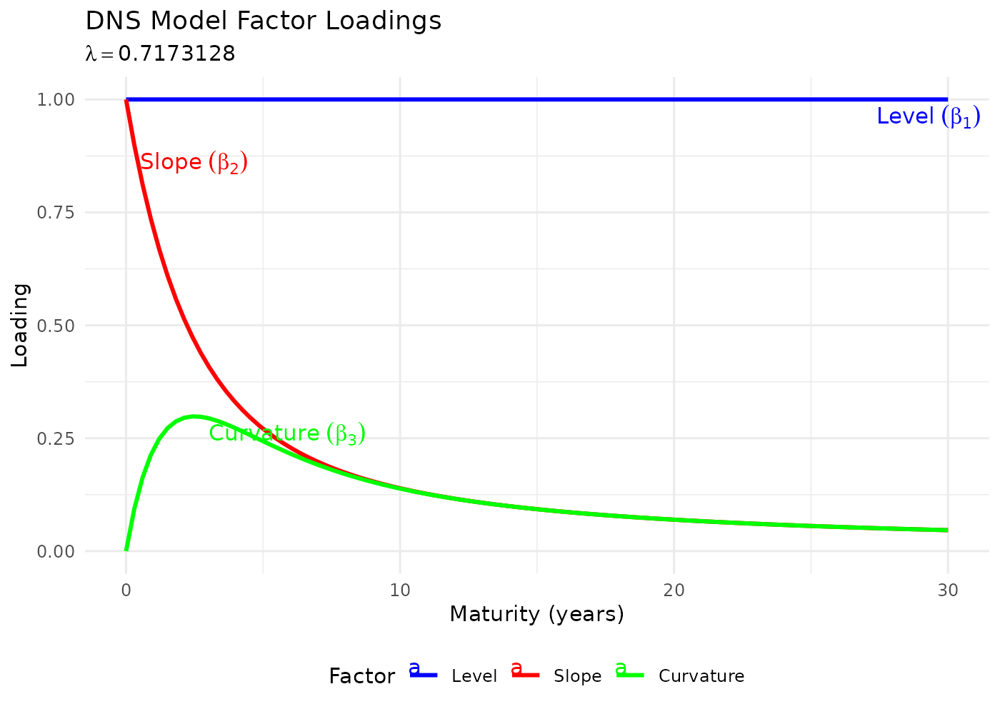
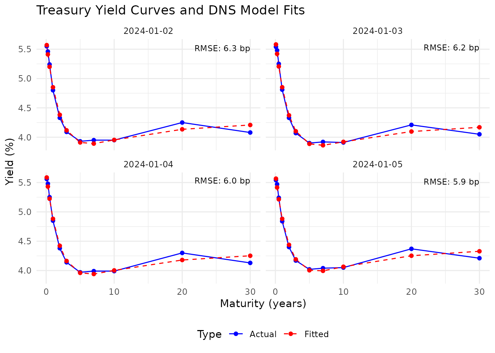
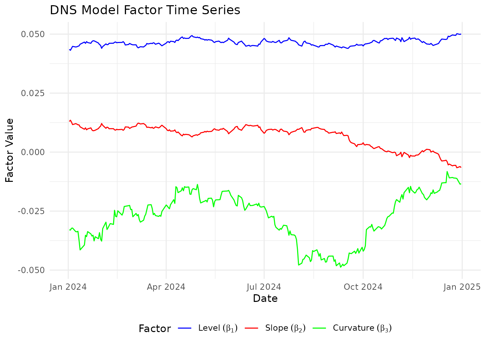
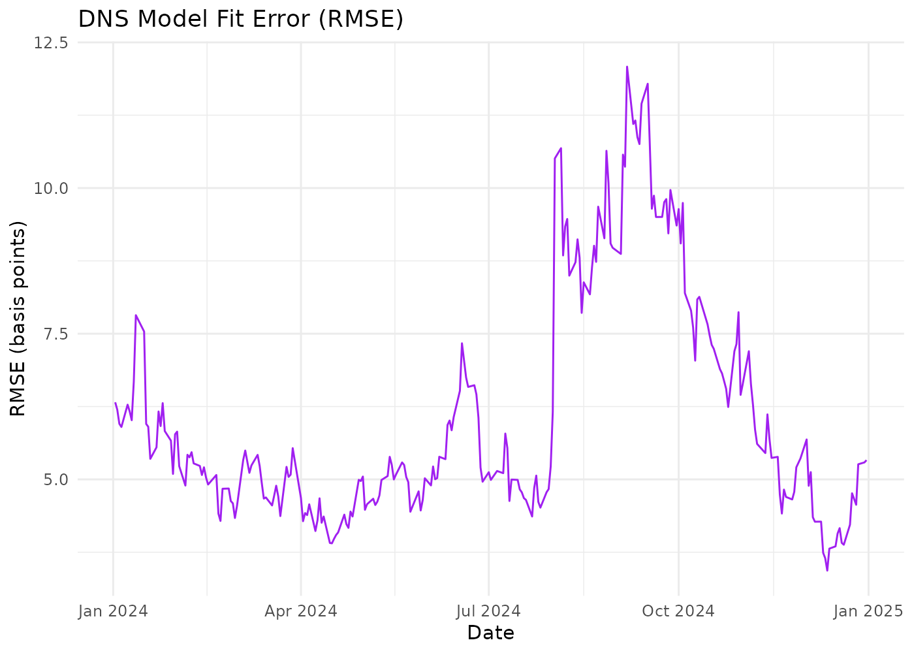
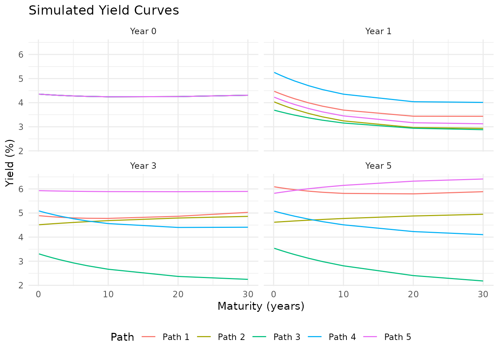
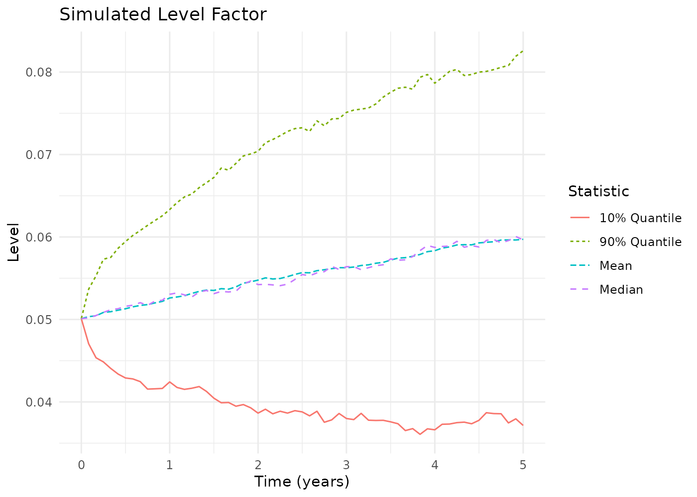
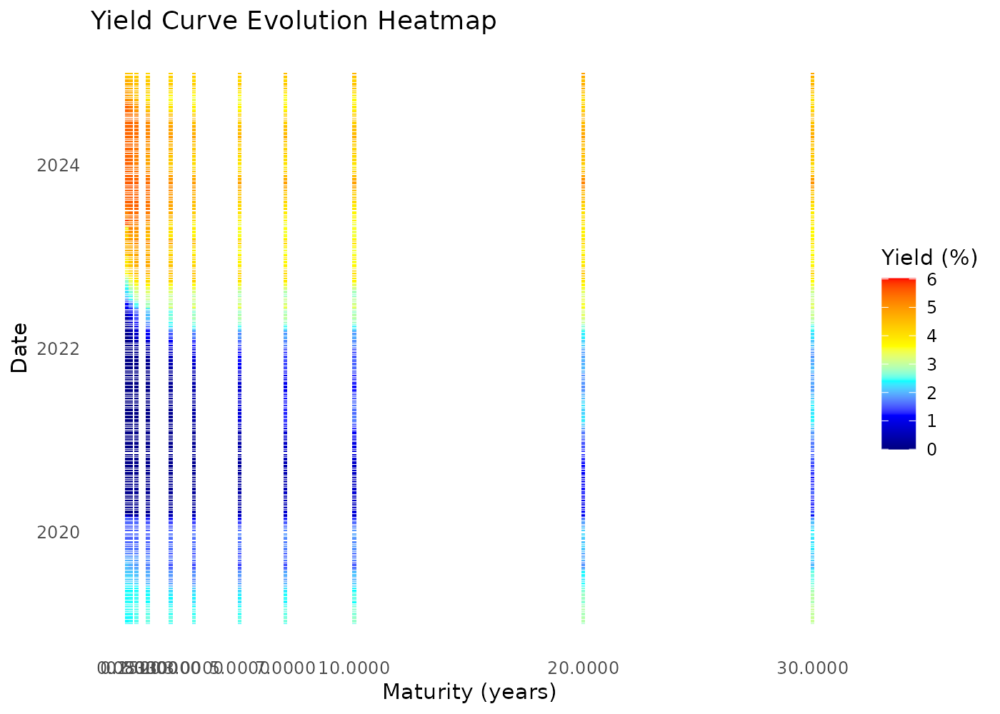
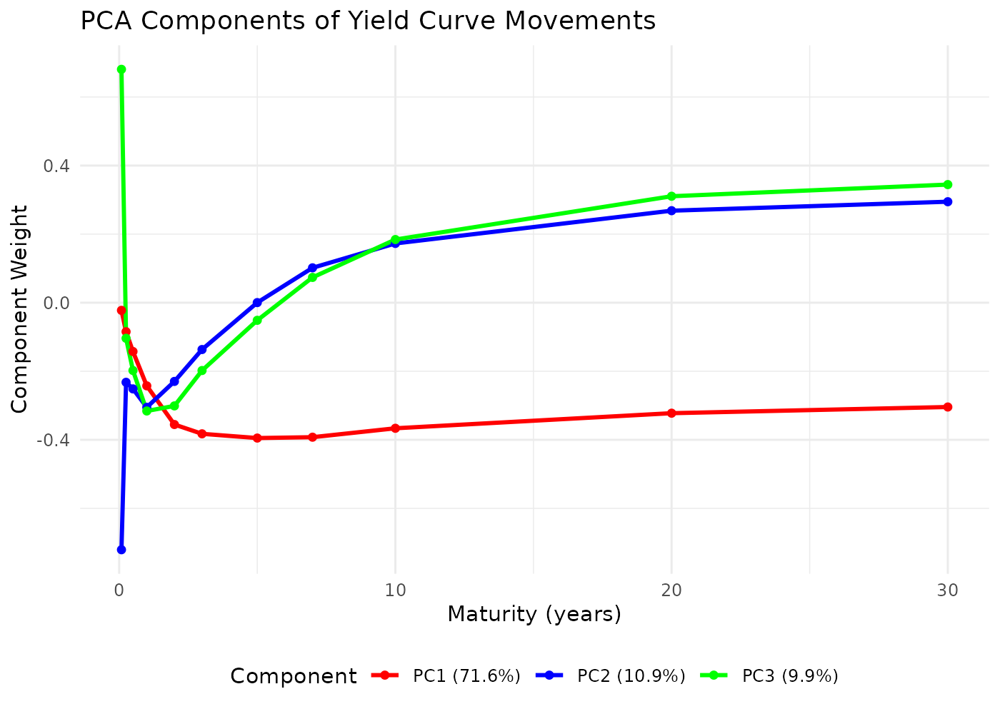
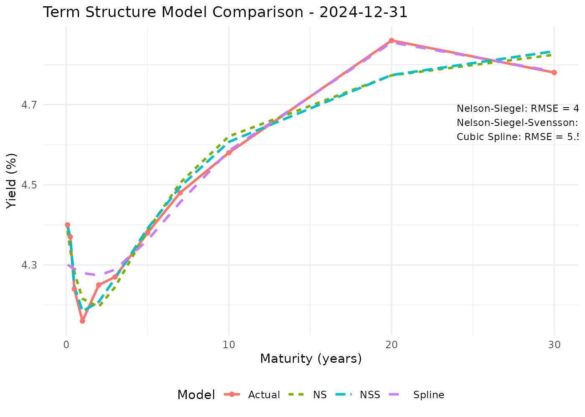

# Introduction to the Dynamic Nelson-Siegel Model

## Overview

The `dnsr` package implements the Dynamic Nelson-Siegel (DNS) model for
yield curve modelling. This vignette walks the whole workflow: fitting
the curve, estimating how its factors move, simulating forward, and
pricing off the result.

Everything here runs against `treasury_yields`, a six-year panel of real
U.S. Treasury curves that ships with the package, so none of it needs a
FRED API key. For live data see
[`vignette("fred-api-setup", package = "dnsr")`](https://ambientpointcorp.github.io/dnsr/articles/fred-api-setup.md),
and for the YUIMA simulation engine see
[`vignette("dnsr-yuima-integration", package = "dnsr")`](https://ambientpointcorp.github.io/dnsr/articles/dnsr-yuima-integration.md).

``` r

library(dnsr)
data(treasury_yields)

dim(treasury_yields)
#> [1] 1501   12
range(treasury_yields$Date)
#> [1] "2019-01-02" "2024-12-31"
```

The frame is the shape every function in the package expects: a `Date`
column followed by one column per maturity, named by maturity in years,
with yields in decimal form.

``` r

treasury_yields[1:3, 1:6]
#>         Date 0.0833   0.25    0.5      1      2
#> 1 2019-01-02 0.0240 0.0242 0.0251 0.0260 0.0250
#> 2 2019-01-03 0.0242 0.0241 0.0247 0.0250 0.0239
#> 3 2019-01-04 0.0240 0.0242 0.0251 0.0257 0.0250
```

## The Nelson-Siegel Model

The Nelson-Siegel model is a parsimonious parametric model for the yield
curve. It expresses the yield at each maturity through three factors:

``` math
y(m) = \beta_1 + \beta_2 \left(\frac{1-e^{-\lambda m}}{\lambda m}\right) + \beta_3 \left(\frac{1-e^{-\lambda m}}{\lambda m} - e^{-\lambda m}\right)
```

where

- $`y(m)`$ is the yield at maturity $`m`$,
- $`\beta_1`$ is the long-term level of interest rates,
- $`\beta_2`$ is the slope, short-term minus long-term,
- $`\beta_3`$ is the curvature, the size of the hump,
- $`\lambda`$ controls how fast the factor loadings decay.

The loadings are what give each factor its interpretation: the level
loads equally on every maturity, the slope loads most at the short end
and decays to zero, and the curvature peaks somewhere in the middle.

### A word about lambda, because its units matter

$`\lambda`$ appears only as the product $`\lambda m`$, so it is measured
per unit of maturity. Its numerical value therefore depends on whether
maturities are years or months, and nothing about a $`\lambda`$ on its
own tells you which. **Every function in this package takes maturities
in years.**

This is worth labouring because the conventional value is a trap.
Diebold and Li chose $`\lambda = 0.0609`$ working in *months*, where it
places the curvature hump just short of 30 months. That is the number
this package uses as a default, and in years it means something quite
different:

``` r

ns_curvature_peak(0.0609)   # where the hump sits, in the maturity's own units
#> [1] 29.44634
```

Twenty-nine years, which is off the end of most curves: the “curvature”
factor is then doing almost nothing a level factor could not.
[`ns_lambda()`](https://ambientpointcorp.github.io/dnsr/reference/ns_lambda.md)
goes the other way, from the maturity you want the hump at to the decay
that puts it there:

``` r

ns_lambda(2.5)   # a hump at two and a half years
#> [1] 0.7173128
ns_lambda(30)    # the Diebold-Li criterion, in the months they worked in
#> [1] 0.05977607
```

So the honest reading of `0.0609` is that it is right for
month-denominated maturities and merely conventional here. Compare the
two:

``` r

plot_dns_loadings(lambda = 0.0609)
```



``` r

plot_dns_loadings(lambda = ns_lambda(2.5))
```



The first has no hump to speak of inside thirty years. The second is the
shape the three-factor story describes.

This is not a cosmetic point. At $`\lambda = 0.0609`$ the *slope*
loading only falls from 0.992 at three months to 0.749 at ten years –
nearly flat, and so nearly collinear with the level loading, which is 1
everywhere. The two factors stop being separately identified, and
$`\beta_2`$ stops behaving like a slope at all. Fitting the same panel
both ways and comparing $`\beta_2`$ with the spread the market quotes:

| $`\lambda`$ | hump at | cor($`\beta_2`$, 3m-10y) | same sign | median fit |
|------------:|--------:|-------------------------:|----------:|-----------:|
|      0.0609 |  29.5 y |               **-0.929** |    **5%** |    23.0 bp |
|       0.448 |   4.0 y |               **+0.941** |   **90%** |     5.3 bp |

At the default the slope factor is *anti*-correlated with the slope, and
carries the right sign on one date in twenty. That is the cost of the
unit mismatch, and it is why the rest of this vignette fixes $`\lambda`$
somewhere sensible rather than at the default.

Two cautions before leaning on
[`ns_lambda()`](https://ambientpointcorp.github.io/dnsr/reference/ns_lambda.md).
The peak is flat – at half or double the nominal peak maturity the
curvature loading is still about 85 percent of its maximum – so
$`\lambda`$ is not tightly pinned by this choice and the precision of
the number is misleading. And $`\lambda`$ sets the slope loading’s decay
at the same time, which is often the more consequential effect: a hump
at 2.5 years leaves the slope loading at 0.53 by two years, a hump at 10
years leaves it at 0.84. Where $`\lambda`$ can be estimated rather than
chosen, estimate it.

## Dynamic Extension

The DNS model lets the three factors vary over time, each as an
Ornstein-Uhlenbeck process:

``` math
d\beta_i(t) = \kappa_i(\theta_i - \beta_i(t))dt + \sigma_i dW_i(t)
```

with $`\kappa_i`$ the speed of mean reversion, $`\theta_i`$ the long-run
mean, $`\sigma_i`$ the volatility and $`W_i(t)`$ a Wiener process.
Fitting the curve is therefore two steps: a cross-sectional fit on each
date, then a time-series estimate of how the resulting factors move.

## Fitting a Single Curve

[`fit_ns_model()`](https://ambientpointcorp.github.io/dnsr/reference/fit_ns_model.md)
fits one cross-section. The `"profile"` method solves the three betas in
closed form at each $`\lambda`$ and searches only over $`\lambda`$, so
it needs no starting values:

``` r

maturities <- as.numeric(setdiff(names(treasury_yields), "Date"))
latest <- as.numeric(treasury_yields[nrow(treasury_yields), -1])

curve <- fit_ns_model(maturities, latest, method = "profile")
#> Warning in fit_ns_model(maturities, latest, method = "profile"): Nelson-Siegel
#> fit rests on a parameter bound (lambda); the factor decomposition is not
#> identified. Widen lower_bounds/upper_bounds or check the yield scale.
curve
#> Nelson-Siegel curve fit
#>   beta1 (level)     0.04988
#>   beta2 (slope)     -0.00617
#>   beta3 (curvature) -0.01404
#>   lambda            0.50000
#>   rmse              4.95 bp over 11 maturities
#>   at bound          lambda (decomposition not identified)
```

That warning is worth taking seriously rather than silencing. The fit
reports any parameter that came to rest on one of its bounds, because a
clamped fit can still look respectable on RMSE while the factor
decomposition means nothing, and `L-BFGS-B` reports convergence at a
bound, so `success` alone cannot tell you.

``` r

curve$at_bound
#>  beta1  beta2  beta3 lambda 
#>  FALSE  FALSE  FALSE   TRUE
```

Here the default ceiling on $`\lambda`$, 0.5, is genuinely binding: this
curve wants a faster decay than the conventional value allows. Given
room, it finds an interior optimum and fits better:

``` r

wider <- fit_ns_model(maturities, latest, method = "profile",
                      lower_bounds = c(-1, -1, -1, 0.01),
                      upper_bounds = c(1, 1, 1, 5))
c(lambda = wider$parameters[["lambda"]], rmse_bp = wider$rmse * 10000)
#>    lambda   rmse_bp 
#> 0.6687707 4.4314318
```

## Fitting the Panel

[`fit_dns_model()`](https://ambientpointcorp.github.io/dnsr/reference/fit_dns_model.md)
fits every date. The window is selected by date, so it does not matter
which row order the panel arrives in.

For a panel there is a choice to make that does not arise for a single
curve. If $`\lambda`$ is estimated freely it varies from date to date –
on this data from 0.04 to 0.50 – and then $`\beta_2`$ on one date does
not mean the same thing as $`\beta_2`$ on the next, because the loading
it multiplies has changed shape. The betas stop being a comparable time
series, which is precisely what the next step needs them to be.

Standard DNS practice, following Diebold and Li, therefore fixes
$`\lambda`$ at a single value for the whole panel. It costs
cross-sectional fit – about 14 basis points median here against 7 with
$`\lambda`$ free – and buys factors that can be modelled over time.

`ns_lambda(4)` puts the curvature hump at four years, which is about
where this panel wants it, and keeps the loadings distinct enough for
the factors to mean what they are called:

``` r

recent <- fit_dns_model(treasury_yields, n_days = 250, show_progress = FALSE,
                        lambda_constraint = "fixed",
                        initial_lambda = ns_lambda(4))
recent
#> Dynamic Nelson-Siegel fit
#>   250 curves, 2024-01-02 to 2024-12-31
#>   maturities         0.0833  0.2500  0.5000  1.0000  2.0000  3.0000  5.0000  7.0000 10.0000 20.0000 30.0000
#>   rmse              5.28 bp median, 12.08 bp worst
#>   lambda            0.4483 median
#>   success rate      100.0%
```

[`summary()`](https://rdrr.io/r/base/summary.html) gives the
distribution of each factor and of the fit error:

``` r

summary(recent)
#> Dynamic Nelson-Siegel fit
#>   250 curves, 2024-01-02 to 2024-12-31, 100.0% fitted
#> 
#> Factors:
#>             min     mean      max      sd
#> beta1   0.04314  0.04649  0.05018 0.00135
#> beta2  -0.00663  0.00680  0.01352 0.00484
#> beta3  -0.04876 -0.02768 -0.00824 0.01029
#> lambda  0.44832  0.44832  0.44832 0.00000
#> 
#> Fit error (basis points):
#>    0%   50%   95%  100% 
#>  3.43  5.28 10.24 12.08
```

Fitted curves against the observations:

``` r

plot_yield_curves(treasury_yields, recent, max_plots = 4)
```



And the factors over time:

``` r

factor_plots <- plot_factor_time_series(recent)
factor_plots$factors
```



``` r

factor_plots$rmse
```



### Do the factors mean what they claim?

The three factors are supposed to be level, slope and curvature. That is
checkable, and worth checking before anything is built on them. The
slope factor should track the spread the market actually quotes:

``` r

aligned <- treasury_yields[match(recent$parameters$Date, treasury_yields$Date), ]
observed_spread <- aligned[["0.25"]] - aligned[["10"]]

c(
  correlation = cor(recent$parameters$beta2, observed_spread),
  same_sign = mean(sign(recent$parameters$beta2) == sign(observed_spread))
)
#> correlation   same_sign 
#>   0.9410184   0.9040000
```

Closely, and with the sign the algebra predicts: the slope loading is 1
at the short end and decays to zero, so
$`y(\text{short}) \approx \beta_1 + \beta_2`$ and
$`y(\text{long}) \approx \beta_1`$, which makes $`\beta_2`$ the
short-minus-long spread. A positive $`\beta_2`$ is an inverted curve.

And the level factor should look like the policy cycle:

``` r

range(recent$parameters$beta1)
#> [1] 0.04314035 0.05018489
```

### Where a three-factor curve runs out

The median fit error is a summary; the structure of the residuals says
more. Three factors cannot bend arbitrarily, and the place they struggle
is predictable:

``` r

fitted_rows <- recent$fitted_yields
residual <- as.matrix(aligned[, -1]) - fitted_rows

data.frame(
  maturity = as.numeric(colnames(fitted_rows)),
  mean_bp = round(colMeans(residual, na.rm = TRUE) * 10000, 1),
  rmse_bp = round(sqrt(colMeans(residual^2, na.rm = TRUE)) * 10000, 1)
)
#>        maturity mean_bp rmse_bp
#> 0.0833   0.0833     0.1     7.9
#> 0.25     0.2500     3.3     5.0
#> 0.5      0.5000     1.1     6.1
#> 1        1.0000    -4.7     8.5
#> 2        2.0000    -2.7     5.5
#> 3        3.0000    -0.5     1.9
#> 5        5.0000     1.5     4.3
#> 7        7.0000     3.1     5.0
#> 10      10.0000    -1.2     3.2
#> 20      20.0000     8.6     8.7
#> 30      30.0000    -8.7     9.4
```

The errors are not spread evenly. The middle of the curve, where the
curvature factor is doing its work, fits to a couple of basis points;
the two ends are three to five times worse, and the long end carries a
visible bias – twenty years is fitted low and thirty high, the signature
of a single exponential decay being asked to describe a curve that
flattens faster than it can. The one-month point is poorly fitted for a
different reason: it is barely on the same curve as the rest, and no
three-factor shape passes through both the bill market and the
thirty-year.

Which end matters is a property of your application, not of the model.
If you are discounting long cashflows, the median RMSE is the wrong
summary to be reassured by.

## Estimating Factor Dynamics

[`estimate_dns_dynamics()`](https://ambientpointcorp.github.io/dnsr/reference/estimate_dns_dynamics.md)
regresses each factor’s change on its lagged level. By default it
samples the factor series at month-ends and estimates at
$`\Delta t = 1/12`$: daily cross-sectional refits carry measurement
noise that is serially uncorrelated, and an OU regression on daily
changes reads that noise as mean reversion, inflating $`\kappa`$ by an
order of magnitude.

Because the estimation uses month-ends anyway, fitting only those is
enough and is far quicker. `warm_start = FALSE` makes each cross-section
independent of which other dates are in the panel, so these fits are the
ones fitting every day would have produced:

``` r

month_ends <- treasury_yields[
  !duplicated(format(treasury_yields$Date, "%Y-%m"), fromLast = TRUE),
]
monthly_fit <- fit_dns_model(month_ends, n_days = nrow(month_ends),
                             show_progress = FALSE, warm_start = FALSE,
                             lambda_constraint = "fixed",
                             initial_lambda = ns_lambda(4))

dynamics <- estimate_dns_dynamics(monthly_fit$parameters)
dynamics
#> DNS factor dynamics
#>   estimated on     2019-02-28 to 2024-12-31
#>   sampling         monthly (dt = 1/12), 71 observations
#>   structure        diagonal
#> 
#>                 kappa se_kappa   theta  sigma half_life_y
#> level (b1)     0.0604   0.3379  0.0862 0.0088     11.4707
#> slope (b2)     0.3534   0.3484 -0.0058 0.0114      1.9614
#> curvature (b3) 1.5237   0.7038 -0.0150 0.0306      0.4549
#> 
#>   stable           TRUE (eigenvalues 1.524 0.353 0.060)
```

The standard errors are worth reading before anything is built on
$`\kappa`$. Mean reversion is weakly identified in a sample this short,
and the half-life interval says so:

``` r

dynamics$beta1$se
#>        kappa        theta        sigma 
#> 0.3378614464 0.3157739879 0.0007482356
dynamics$beta1$t_value
#>     kappa     theta 
#> 0.1788525 0.2730089
dynamics$beta1$half_life_ci
#>     lower     upper 
#> 0.9592091       Inf
```

$`\kappa`$ also carries a well-known upward small-sample bias of order
$`5/T`$ in a sample of $`T`$ years, which these standard errors describe
nothing about: they are sampling noise, not bias.

Factor innovations are correlated, and the simulation uses that:

``` r

round(dynamics$correlation, 3)
#>        beta1  beta2  beta3
#> beta1  1.000 -0.548  0.132
#> beta2 -0.548  1.000 -0.302
#> beta3  0.132 -0.302  1.000
```

### A full mean-reversion matrix

By default the three factors revert independently. `structure = "full"`
estimates the Diebold-Li VAR(1) instead, in which a shock to one factor
pulls the others:

``` r

full <- estimate_dns_dynamics(monthly_fit$parameters, structure = "full")
round(full$kappa_matrix, 3)
#>        beta1  beta2  beta3
#> beta1  0.436 -0.494 -0.391
#> beta2 -1.190  0.866 -0.843
#> beta3  0.921  0.634  1.674
```

The eigenvalues of that matrix decide whether the system is stable,
which a diagonal reconstruction would get wrong whenever the cross terms
matter:

``` r

round(Re(full$eigenvalues), 3)
#> [1] 1.175 1.175 0.627
full$system_stability
#> [1] TRUE
```

## Is the Fit Trustworthy?

The package reports its own reliability in several places, and they are
easy to miss because each one lives on a different object. Worth
checking all of them before using a calibration:

``` r

# 1. Did every cross-section fit at all?
recent$success_rate
#> [1] 100
nrow(recent$failures)
#> [1] 0

# 2. Did any fit come to rest on a bound? Those factor decompositions are not
#    identified, however good their RMSE looks.
colSums(recent$at_bound)
#>  beta1  beta2  beta3 lambda 
#>      0      0      0      0

# 3. How bad is the worst curve, not just the median?
round(quantile(recent$parameters$rmse * 10000, c(0.5, 0.95, 1)), 2)
#>   50%   95%  100% 
#>  5.28 10.24 12.08

# 4. Is the estimated factor system actually mean reverting?
dynamics$system_stability
#> [1] TRUE
round(Re(dynamics$eigenvalues), 3)
#> [1] 1.524 0.353 0.060

# 5. How well identified is the reversion speed?
dynamics$beta1$half_life_ci
#>     lower     upper 
#> 0.9592091       Inf
```

Taken together: a high success rate with no bound hits, a tolerable
worst-case RMSE, a stable system, and a half-life interval you would be
willing to quote. If the half-life interval runs to infinity, as it does
on this six-year sample, $`\kappa`$ is not identified and any simulation
horizon longer than the sample is an extrapolation of something the data
did not pin down.

## Simulating Future Yield Curves

The factor system is a linear SDE whose diffusion does not depend on the
state, so its transition law over any step is a known Gaussian.
`engine = "exact"` samples that law directly: no discretisation error at
any step size, and no extra package.

``` r

latest_row <- monthly_fit$parameters[which.max(monthly_fit$parameters$Date), ]
initial_factors <- as.numeric(latest_row[c("beta1", "beta2", "beta3")])

sim_params <- dns_dynamics_to_sim_params(dynamics, lambda = latest_row$lambda)

simulation <- simulate_dns_yield_curves(
  params = sim_params,
  initial_factors = initial_factors,
  maturities = maturities,
  time_horizon = 5,
  n_steps = 60,
  n_paths = 500,
  engine = "exact",
  seed = 1
)
simulation
#> DNS simulation
#>   500 paths, 60 steps over 5 years
#>   engine           exact
#>   terminal factors 0.0597  -0.0065  -0.0145
#>     (sd)           0.0177  0.0135  0.0173
#>   maturities        0.0833  0.2500  0.5000  1.0000  2.0000  3.0000  5.0000  7.0000 10.0000 20.0000 30.0000
#>   terminal yields  5.32  5.31  5.31  5.30  5.28  5.26  5.23  5.21  5.19  5.18  5.24 (% mean)
```

Simulated curves at a few horizons. The facets follow the calendar
rather than sorting lexically, so “Year 5” comes after “Year 3”:

``` r

yield_plots <- plot_simulated_yields(
  simulation,
  time_points = c(0, 1, 3, 5),
  path_subset = 1:5
)
yield_plots$yield_curves
```



The factor paths, as a fan of quantiles across all 500 of them:

``` r

plot_simulated_factors(simulation)$level
```



The YUIMA engine remains available and is the default, for the
estimation machinery that comes with it. See
[`vignette("dnsr-yuima-integration", package = "dnsr")`](https://ambientpointcorp.github.io/dnsr/articles/dnsr-yuima-integration.md).

## Pricing off a Fitted Curve

A fitted curve is only useful if it discounts cashflows. The DNS curve
gives continuously compounded zero rates, so the discount factor at
maturity $`m`$ is $`P(m) = \exp(-y(m)\,m)`$:

``` r

factors <- matrix(curve$parameters[1:3], nrow = 1)
lambda <- curve$parameters[["lambda"]]

coupon_maturities <- c(0.5, 1, 2, 5, 10, 30)
data.frame(
  maturity = coupon_maturities,
  zero_pct = round(calculate_dns_yields(factors, coupon_maturities, lambda)[1, ] * 100, 3),
  discount = round(dns_discount_factors(factors, coupon_maturities, lambda)[1, ], 4),
  price_100 = round(dns_zero_prices(factors, coupon_maturities, lambda)[1, ], 2),
  par_pct = round(dns_par_yields(factors, coupon_maturities, lambda)[1, ] * 100, 3)
)
#>   maturity zero_pct discount price_100 par_pct
#> 1      0.5    4.293   0.9788     97.88   4.339
#> 2      1.0    4.249   0.9584     95.84   4.295
#> 3      2.0    4.227   0.9189     91.89   4.272
#> 4      5.0    4.361   0.8041     80.41   4.400
#> 5     10.0    4.596   0.6316     63.16   4.614
#> 6     30.0    4.853   0.2332     23.32   4.827
```

Par yields are the coupon rate that prices a bullet bond at par. They
differ from the zero yields for two reasons that can pull in opposite
directions: a compounding convention term, since the curve is
continuously compounded while the par rate pays twice a year, and a
shape term, since coupons are discounted at the earlier rates rather
than the terminal one. The first dominates at the short end and the
second further out.

Forward rates come off the same factors:

``` r

rbind(
  spot = round(calculate_dns_yields(factors, coupon_maturities, lambda)[1, ] * 100, 3),
  forward = round(calculate_dns_forwards(factors, coupon_maturities, lambda)[1, ] * 100, 3)
)
#>          [,1]  [,2]  [,3]  [,4]  [,5]  [,6]
#> spot    4.293 4.249 4.227 4.361 4.596 4.853
#> forward 4.234 4.188 4.244 4.649 4.936 4.988
```

## Looking at the Panel

A heatmap of the whole panel shows the 2020 collapse to near-zero short
rates and the 2022-2023 inversion:

``` r

plot_yield_heatmap(treasury_yields)
```



Principal components of the daily changes. Decomposing the covariance
matrix rather than standardising each maturity first is the usual
convention for yield curves, and is what produces the familiar level,
slope and curvature shapes:

``` r

pca <- plot_yield_pca(treasury_yields, scale = FALSE)
round(pca$var_explained[1:3], 4)
#> [1] 0.7160 0.1087 0.0991
pca$plots$weights
```



The first three components are the empirical counterpart of the model’s
three factors, which is the reason a three-factor curve works as well as
it does.

## Comparing Term Structure Models

[`compare_term_structure_models()`](https://ambientpointcorp.github.io/dnsr/reference/compare_term_structure_models.md)
fits several curves to one cross-section and reports the error of each,
in basis points:

``` r

comparison <- compare_term_structure_models(
  treasury_yields,
  models = c("NS", "NSS", "Spline")
)
comparison$metrics
#>                    Model     RMSE      MAE  MaxError
#> 1          Nelson-Siegel 8.873355 7.506098 15.404612
#> 2 Nelson-Siegel-Svensson 3.542643 2.502529  8.621915
#> 3           Cubic Spline 5.561295 3.995767 11.985578
```

``` r

comparison$plot
```



Nelson-Siegel-Svensson adds a second curvature term with its own decay,
so it nests Nelson-Siegel and must fit at least as well; the question is
whether the two extra parameters are worth it. A smoothing spline will
generally beat both on in-sample error while saying nothing about the
shape, which is the trade the parametric models exist to make.

## What This Package Does Not Do

Two limits are worth stating plainly, because they are choices rather
than omissions.

**It estimates in two steps, not one.** Each cross-section is fitted,
and then the resulting factors are treated as data for a time-series
model. Diebold, Rudebusch and Aruoba cast the same model as a
state-space system and estimate everything at once with a Kalman filter,
which propagates the cross-sectional uncertainty into the dynamics
instead of discarding it, and handles missing maturities naturally. The
two-step approach is simpler, much faster, and what the original
Diebold-Li paper used; it is also why the standard errors here describe
the factor regressions and not the factors’ own measurement error.

**It carries no arbitrage-free restriction.** Nelson-Siegel is a
flexible curve, not a term structure model derived from a no-arbitrage
condition, so nothing stops a fitted or simulated curve implying
arbitrage. The arbitrage-free variant, AFNS, adds a yield-adjustment
term that pins the dynamics and the cross-section together. If you are
pricing derivatives off these curves rather than discounting cashflows,
that distinction matters.

## Where to Go Next

``` r

# Live Treasury data, caching and the API key
vignette("fred-api-setup", package = "dnsr")

# The YUIMA engine, and quasi-maximum-likelihood estimation
vignette("dnsr-yuima-integration", package = "dnsr")
```

[`get_calibrated_dns_params()`](https://ambientpointcorp.github.io/dnsr/reference/get_calibrated_dns_params.md)
wraps the whole path above into one call, from downloading data to
returning simulation-ready parameters, for when the intermediate objects
are not needed.
